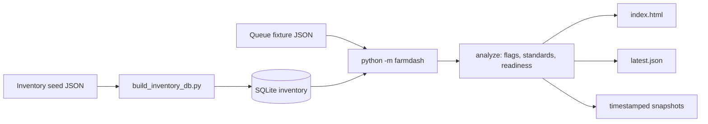

# Render farm dashboard

A read-only dashboard that shows the health of a small render farm: worker state, recent errors, GPU driver and plugin versions, and whether each job has enough ready workers.

It does not talk to a live farm manager or inventory product. The bundled demo uses a JSON queue fixture and a local SQLite inventory database built from a seed file. All host names, user names, job names, and hardware in this repository are synthetic.

The queue adapter is a stand-in for a farm manager (for example a Deadline-style queue). The inventory adapter is a stand-in for an asset-inventory database. Both are narrow interfaces, so they can be replaced later without changing the analysis or the HTML page.

## How it is put together



`python -m farmdash` loads both sources, merges them by machine name, and writes a single self-contained HTML page plus JSON snapshots. `--check` does the same analysis and prints a summary without writing files.

Farm standard for the GPU driver and for each plugin is the value in `config.example.json` when set, otherwise the most common value among queue workers. Ties go to the higher version.

Severity, from low to high:

- **info** — version drift against the most common value (no standard has been chosen yet)
- **warning** — offline, a few recent errors, stale inventory, or drift against a configured standard
- **serious** — five or more errors in the window (default 24 hours)
- **critical** — stalled worker

A worker is a **candidate** for a job when it is in the job's group and pool. It is **ready** when it is a candidate, is not offline or stalled, and has the required renderer plugin version.

## How to run the demo

Python 3.12+, no third-party packages at runtime. pytest and ruff are only needed for tests and lint.

```bash
python3.12 -m venv .venv
source .venv/bin/activate
pip install pytest ruff
python scripts/build_inventory_db.py
python -m farmdash --config config.example.json --check
python -m farmdash --config config.example.json
```

Then open `output/index.html` in a browser. The page is one file: filters and styling are inlined, with no external CSS or JS.

Rebuild the inventory database whenever you want scan times to be relative to "now". The seed file uses `last_scan_hours_ago` so farm-09 stays stale and the others stay fresh.

Unit tests and lint:

```bash
pytest
ruff check .
ruff format --check .
```

### PowerShell scanners

`scanners/Get-GpuInfo.ps1` and `scanners/Get-PluginVersion.ps1` are generic, read-only collectors. They never change drivers or plugin files. On a real node, the GPU scanner calls `nvidia-smi`; the plugin scanner reads `version.txt` files under `<InstallRoot>/<AppName>/<AppVersion>/plugins/<PluginName>/`.

Both accept `-TestRoot` so you can run them against the bundled sample tree without a GPU or a local install:

```powershell
.\scanners\Get-GpuInfo.ps1 -TestRoot .\fixtures\scanner-samples
.\scanners\Get-PluginVersion.ps1 -TestRoot .\fixtures\scanner-samples\apps
```

## Results from the demo fixture

These numbers are from running the CLI against the bundled synthetic fixture (12 queue workers, 14 inventory machines including two artist workstations that are not part of the farm) on Sat Nov 21, 2026, 2:37 AM PT:

```
Inventory: 14 machines | Queue: 12 workers | nodes: 12 | need attention: 6 | errors 24h: 9 | jobs: 5 (3 active)
```

| Worker   | State     | Flags |
|----------|-----------|--------|
| farm-01  | idle      | none |
| farm-02  | rendering | none |
| farm-03  | stalled   | critical: stalled 5h ago |
| farm-04  | offline   | warning: offline 18h ago |
| farm-05  | idle      | serious: 6 errors in 24h (all VRAM) |
| farm-06  | idle      | warning: 2 errors in 24h (license) |
| farm-07  | idle      | info: GPU driver 551.86 vs farm standard 566.14 |
| farm-08  | idle      | info: LightTrace 3.8.2 vs farm standard 3.9.0 |
| farm-09  | idle      | warning: inventory stale (40h ago) |
| farm-10  | idle      | warning: 1 error in 24h (crash) |
| farm-11  | idle      | info: GPU driver 551.86 vs farm standard 566.14 |
| farm-12  | rendering | none |

- **6 of 12** workers need attention (warning or higher). One is critical.
- Worker states: 8 idle, 2 rendering, 1 stalled, 1 offline.
- **9** recent errors: 6 VRAM, 2 license, 1 crash.
- Farm standard (most common): GPU driver **566.14** (10 of 12 workers), LightTrace **3.9.0** (11 of 12). Artist workstations are not counted toward the standard.
- Jobs (ready / candidates): `demo_spot_A` 9/12, `demo_spot_B` 9/12, `training_reel_01` 1/12 (needs LightTrace 3.8.2, only farm-08 has it), `product_loop_v3` 3/3 (priority pool), `color_study_alpha` 2/2 (gpu-heavy group). None of the five jobs were flagged.

The generated page was **20,908** bytes, with inline CSS and JS only.

## Config

Copy `config.example.json` to `config.json` if you want a local override (`config.json` is gitignored). Paths in the config are resolved relative to the config file. Useful keys:

- `error_window_hours` (default 24) and `error_burst_count` (default 5)
- `stale_scan_hours` (default 26)
- `keep_snapshots_days` (default 14)
- `standards.driver_version` and `standards.plugins.LightTrace` — leave empty to use the most common value; set them to promote drift from info to warning

## License

MIT, Copyright (c) 2026 Paul Kosal
